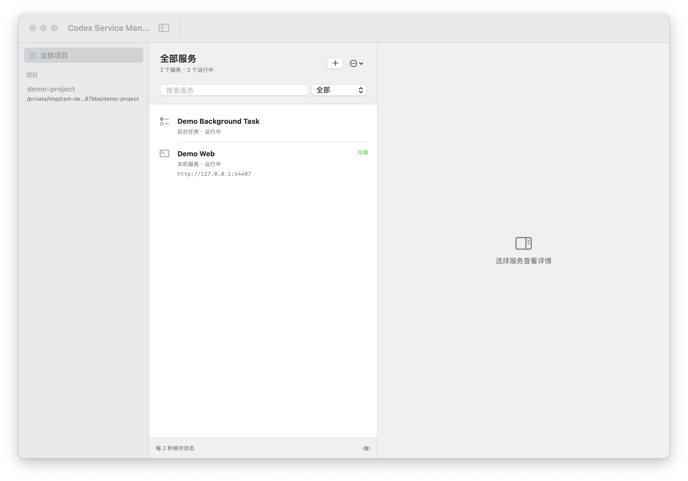

# Codex Service Manager

一个供个人开发使用的原生 macOS 服务管理应用。本项目是独立第三方工具，与 OpenAI 没有官方关联。主要用于管理 Codex 在本机开发时启动的服务：通过配套入口按项目登记前端、后端、后台任务、Docker 容器和 Compose 服务，查看状态、启停、日志与运行历史。

当前版本已完成本机 A-01 至 A-16 验收，包含真实 Codex 退出检测。真实桌面实测环境为 Apple Silicon / macOS 15.7.3；构建目标 macOS 13+。macOS 14/15 的构建与引擎回归已通过 GitHub CI；Intel 和其他系统版本的窗口/Codex 退出流程尚未人工验收。



截图来自实际应用的独立测试状态，[图片来源与复核](docs/images/README.md)。

## 功能

- 项目归属与搜索：使用规范化工作目录区分项目，支持运行中和需关注筛选。
- 全局自动观察（开发分支）：已审核并加载用户级 hooks 的新聊天，常见 TCP 服务与持续后台任务自动显示；旧聊天及复杂脚本覆盖仍待补齐。
- 项目管理（开发分支）：修改显示名称、预览并删除无活动/未知服务的项目登记；支持撤销和恢复，不删除源码/容器/卷。
- 状态：区分进程运行状态、HTTP/容器健康与管理组件不可用。
- 控制：停止、启动已保存服务、重启；任务取消和重新执行。停止失败时禁止继续重启。
- Docker/Compose：单容器、单成员、整组控制；停止保留容器与数据，组成员操作去重。
- 历史：每次运行独立记录可获取的起止、结果与诊断；配套入口采集退出码和按运行滚动的日志，观察对象不补回未采集信息。
- 项目结束：每个项目独立选择手动结束、退出 Codex、两者或持续运行；服务可设置保留例外。
- 原生界面：主窗口、系统菜单栏、详情、日志、历史、配置、发现与观察器恢复。

## 构建与启动

需要 macOS 13+ 和 Command Line Tools（Swift 与系统 `/usr/bin/python3`）。缺少工具时运行 `xcode-select --install`，安装完成后再继续。产品 Python 后端仅使用标准库，无需 pip 安装。Docker 功能另需 Docker CLI/Desktop 与 Compose；运行 Java/Node 服务需自行安装其运行时。

```sh
git clone https://github.com/Chillax73/codex-service-manager.git
cd codex-service-manager
/usr/bin/python3 scripts/doctor.py
./scripts/build.sh
open "build/Codex Service Manager.app"
```

构建生成本机 ad-hoc 签名的 `.app`；[v0.1.0 开发者预览](https://github.com/Chillax73/codex-service-manager/releases/tag/v0.1.0) 提供源码构建，未提供可下载安装的应用包或公证安装包。关闭主窗口继续管理；退出管理应用保留服务与独立退出观察器。

## 用户级自动观察（开发分支）

安装一次用户级接入，保留其他 hooks；安装不会授予信任：

```sh
/usr/bin/python3 scripts/install_global_capture.py --instructions
```

在 Codex CLI 的 `/hooks` 中逐项审核本工具的 `PreToolUse`、`PostToolUse`，确认来源为 User config、命令指向 `backend/capture.py hook`。开始新聊天加载配置，无需逐项目修改 AGENTS.md。可用 `/usr/bin/python3 scripts/check_capture_hooks.py /项目目录` 检查来源及 trusted/enabled，再实际启动服务验证。

独立采集组件自动启动，界面标明“自动观察”；这些对象可看状态和历史，暂不参与启停、重启或结束策略。无端口持续任务约 30 秒后显示。本机进程原输出未被接管，不提供历史日志或已知退出码。直接 Docker/Compose 启动有身份/标签证据时自动显示。

当前不补录启用前的既有服务，不覆盖远端或不触发 shell hooks 的路径；采样前已完全脱离进程树的特殊启动脚本、脚本内部未捕获身份的 Docker 操作仍可能漏记。旧聊天配置加载缺口已复现，新开窗口继续同一聊天未解决；当前没有已验收的热加载操作。覆盖与真实桌面验收见 [自动观察报告](docs/results/GLOBAL_CAPTURE.md)，启用/移除见 [接入说明](docs/INTEGRATION.md)。该功能尚未包含在 v0.1.0 标签。

### 另一个窗口启动后没有出现

先区分“新窗口”与“新聊天”：安装前已打开的旧聊天可能没有加载新增 hooks。配置检查脚本启动的是独立短时 app-server，`trusted/enabled` 与采集器心跳正常都不能证明旧聊天实际触发了回调。

当前可用路径是新建聊天验证真实采集，或通过下方配套入口获得完整控制；不要为了登记而重复启动已经运行的业务服务。管理器没有对启用前对象做后台补录，原生发现页也不是自动登记。检查实际 PID/出生身份、端口或 Docker 状态；聊天声称启动完成不能代替现场运行状态。详细步骤见 [排障说明](docs/OPERATIONS.md#另一个聊天或窗口启动服务却没有记录)。

“任意聊天”目标仍有三项待办：旧聊天正常配置加载、后台发现兜底、复杂脚本控制/重启；见 [需求基线](docs/PROJECT_REQUIREMENTS.md) 和 [任务清单](specs/001-service-manager/tasks.md)。

## 接入项目（完整控制）

在当前克隆的根目录初始化本机项目指令：

```sh
# 已有 AGENTS.md 时保留原文件。
[ -f AGENTS.md ] || cp AGENTS.example.md AGENTS.md
/usr/bin/python3 scripts/integrate.py "$PWD"
```

接入其他项目，把最后一个参数改为该项目目录。在 Codex 中重新打开目标项目并开始新会话，确保加载更新的 AGENTS.md；然后让 Codex“按照本项目 AGENTS.md 启动前端/后端服务并登记到服务管理器”。安装器保留原指令、保存首次备份，并写入当前克隆路径的配套入口；生成的本机指令不提交 Git。

```sh
# 以下命令在目标项目目录执行；把入口路径替换为当前克隆的路径。
/path/to/codex-service-manager/scripts/csm launch --name frontend --url http://127.0.0.1:5173 --port 5173 -- npm run dev
/path/to/codex-service-manager/scripts/csm launch --name backend --url http://127.0.0.1:8080/health --port 8080 -- mvn spring-boot:run
/path/to/codex-service-manager/scripts/csm launch --name worker --task -- python3 worker.py
```

服务脱离启动工具进程存活，管理界面显示其记录。已有容器在创建后通过 `csm container` 登记；已有 Compose 项目使用原项目名登记。完整命令见 [接入说明](docs/INTEGRATION.md)。全局自动观察与配套入口去重；完整控制仍依赖保存的可靠启动配置。

## 项目名称、删除与恢复

左侧项目列表右键，或选中项目后打开“更多”菜单，选择“重命名项目…”或“删除项目…”。改名只影响显示名称，目录、服务身份和结束策略保持不变。

删除前会展示登记/历史数量并重新核对服务。运行中、停止失败或身份未知时禁止删除，请先手动处理。删除仅将登记与历史移入本机回收记录，源码目录、容器/卷和日志文件保留；可点击底部“撤销删除”，也可在“更多 → 管理设置 → 已删除项目”恢复。恢复不会启动服务，遇同目录已有登记时拒绝覆盖。回收记录当前没有自动过期或永久清除入口。

该功能在开发分支，尚未包含在 v0.1.0 标签；验证见 [项目管理验收](docs/results/PROJECT_MANAGEMENT.md)。

## Codex Hooks 的作用与使用

发布版与开发分支的接入职责如下：

| 机制 | 职责 |
|---|---|
| `AGENTS.md` + `scripts/csm` | 引导 Codex 遵循项目约定，通过入口启动/登记服务，保存项目归属与每次运行。 |
| 原生退出观察器 | 监听 Codex 应用最后一个实例终止，按项目配置停止服务，保留例外优先。 |
| 开发分支用户级 `backend/capture.py` hooks | 记录启动身份，独立采集服务；已完成一个新桌面聊天的真实工具回调和原生窗口验证。 |
| `validation/` 中的 Codex hooks | 可选的早期实验，仅记录生命周期/工具事件元数据，未接入正式服务自动登记或启停。 |

完整控制按上面的“接入项目”使用；无需逐项目配置的自动观察使用新的用户级采集 hooks，适用当前已验证路径。下面的 `validation/` hooks 仍只是早期事件实验，不是新的采集组件。`SessionEnd` 也可能由归档、删除会话或闲置触发，不能作为应用退出的唯一判断。[OpenAI Hooks 官方说明](https://learn.chatgpt.com/docs/hooks#sessionend)

如需复验 hooks，在本仓库克隆根目录进行：

1. 阅读 `validation/install_hooks.py` 和 `validation/hook_recorder.py`，然后生成本机配置：

   ```sh
   /usr/bin/python3 validation/install_hooks.py
   ```

   生成 `.codex/hooks.json` 和 `validation/hooks.json`，配置五个事件：`SessionStart`、`PreToolUse`、`PostToolUse`、`Stop`、`SessionEnd`。已有不同配置时安装器拒绝覆盖，请先处理冲突或使用独立克隆目录试验。

2. 从此目录启动 `codex` CLI，按正常流程信任项目；在 CLI 内输入 `/hooks`，阅读并信任这些 hooks。安装脚本不授予信任；修改定义后需要重新审核。[官方审核说明](https://learn.chatgpt.com/docs/hooks#review-and-trust-hooks)

3. 可在另一个终端、同一仓库根目录探测配置：

   ```sh
   /usr/bin/python3 validation/verify_hooks.py --project-only
   ```

   它检查配置与信任元数据，不会调用模型，也不证明桌面工具事件已经触发。请核对 `/hooks` 中的本项目配置与启用状态，再让 Codex 执行指南中的无害标记命令，查看本机 `validation/.state/hook-events.jsonl` 的实际事件。

事件文件包含项目路径和会话标识；仅留本机，勿提交 Git 或作为原始附件上传。关闭实验时先在 `/hooks` 禁用本工具条目，再仅移除本工具配置，保留其他 hooks。完整事件复验、路径/版本排障与移除步骤见 [Hooks 使用指南](docs/HOOKS.md)；[原型验证记录](validation/ROUND1_REPORT.md) 与正式产品验收分别保存。

## 结束策略与边界

手动结束默认开启，退出 Codex 默认关闭，两个开关独立。关闭 Codex 窗口、切换/归档聊天或回复结束不会触发退出策略；指定桌面应用最后一个实例终止才触发。系统无法区分普通退出和强制退出，两者都触发；系统关机不保证停止完成。

本机服务先正常停止，等待 5 秒，超时需显式强制停止。容器使用 Docker 原生 5 秒 stop，超时由 Docker 终止。远程服务、任意既有进程接管、开机自启不在当前范围内。

## 验收结果

| 验证类别 | 已通过 |
|---|---:|
| 本机进程集成 | 14 组 |
| 真实 Vite / Spring Boot / Python 项目 | 6 项 |
| Docker / Compose 集成 | 15 项 |
| 真实容器失败场景 | 8 项 |
| 端点、时间与日志契约 | 9 组 |
| 实际原生界面 | 28 项 |

实际退出 Codex 后，本机服务、单容器、两个 Compose 成员共四项按策略停止；保留例外和另一项目继续同次运行，观察器独立存活。用户确认关闭窗口不误停、系统菜单栏详情入口可用。菜单栏快捷控制未逐项重复人工点击，明确保留该验证边界。

测试资源已清理，原有容器状态保持不变。结果见 [验收报告](docs/results/VALIDATION.md)、[机器可读脱敏摘要](docs/results/validation-summary.json)及 [A-01 至 A-16 索引](specs/001-service-manager/acceptance.md)。这些是本机验收记录，不是 GitHub CI 或全平台通过声明。新增自动观察另有 8 组进程、6 项容器断言、一个新桌面聊天与实际原生窗口证据，见 [独立报告](docs/results/GLOBAL_CAPTURE.md)；旧聊天和后台兜底仍未完成。

## 复验

基础测试入口自动创建本机目录，无需手动 mkdir：

```sh
PYTHONDONTWRITEBYTECODE=1 /usr/bin/python3 tests/test_support.py
PYTHONDONTWRITEBYTECODE=1 /usr/bin/python3 tests/test_endpoints.py
PYTHONDONTWRITEBYTECODE=1 /usr/bin/python3 tests/test_engine.py
PYTHONDONTWRITEBYTECODE=1 /usr/bin/python3 tests/test_projects.py
PYTHONDONTWRITEBYTECODE=1 /usr/bin/python3 tests/test_capture.py
```

真实项目测试需要 Node（Vite 要求 `^20.19.0 || >=22.12.0`）、npm、Java 17+、Maven 3.6.3+；工具从 PATH 查找，也可配置 CSM_NPM/CSM_MAVEN。运行 `/usr/bin/python3 scripts/prepare_fixtures.py` 安装锁定的 npm/Maven 夹具依赖，再运行 `tests/verify_projects.py`，默认使用独立测试状态。详细安装、Docker 和 CI 步骤见 [复现与 CI](docs/TESTING.md)。

[GitHub CI](https://github.com/Chillax73/codex-service-manager/actions/workflows/ci.yml) 检查 macOS 构建、Python 回归与发布隐私；[Docker 集成](https://github.com/Chillax73/codex-service-manager/actions/workflows/docker.yml) 独立手动执行。CI 不包含实际窗口、系统菜单栏或真实 Codex 退出，仍需按 [验收索引](specs/001-service-manager/acceptance.md) 人工复验。原始证据仅保存在本机 `docs/evidence/`。

## 使用与维护

最小任务体验、故障排查、移除项目接入、停止独立观察器和数据清理见 [使用与卸载](docs/OPERATIONS.md)。删除数据目录不会停止服务，退出管理应用也不会自动停止观察器。

欢迎通过模板提交问题或建议；开发流程见 [贡献说明](CONTRIBUTING.md)，安全问题使用 [私密反馈](SECURITY.md)。版本变化见 [CHANGELOG](CHANGELOG.md)，开源收尾证据见 [发布核验](docs/results/OPEN_SOURCE_READINESS.md)。

## 许可证

本项目采用 [MIT License](LICENSE)。第三方依赖保留其各自许可，来源和分发边界见 [THIRD_PARTY_NOTICES](THIRD_PARTY_NOTICES.md)。

## 隐私

本仓库从脱敏源码快照独立初始化，不携带原私有仓库的 Git 历史。

运行数据保存在 `~/Library/Application Support/Codex Service Manager/`，可通过 `CSM_STATE_DIR` 隔离。应用仅保存必要环境和显式覆盖，UI 隐藏环境值；不要把凭据写入会公开的命令、健康 URL 或日志。

原始 JSON、截图、日志、数据库、本机 hooks 和带绝对路径的项目指令均排除出 Git。发布摘要按字段白名单生成，只保留通过数量、覆盖范围及能力边界，不包含个人路径、邮箱、聊天标识、进程/容器 ID 或环境值。

```sh
# 已有完整本机验收证据时，重新生成脱敏结果。
/usr/bin/python3 scripts/export_results.py
/usr/bin/python3 scripts/check_publish.py
```

## 项目文档

- [需求文档](docs/PROJECT_REQUIREMENTS.md)
- [Coding spec](specs/001-service-manager/spec.md)、[实现设计](specs/001-service-manager/plan.md)、[数据模型](specs/001-service-manager/data-model.md)
- [实施任务](specs/001-service-manager/tasks.md)、[实施报告](docs/IMPLEMENTATION_REPORT.md)、[自动观察验收与限制](docs/results/GLOBAL_CAPTURE.md)
- [第一轮原型记录](validation/ROUND1_REPORT.md)（独立于产品验收）
