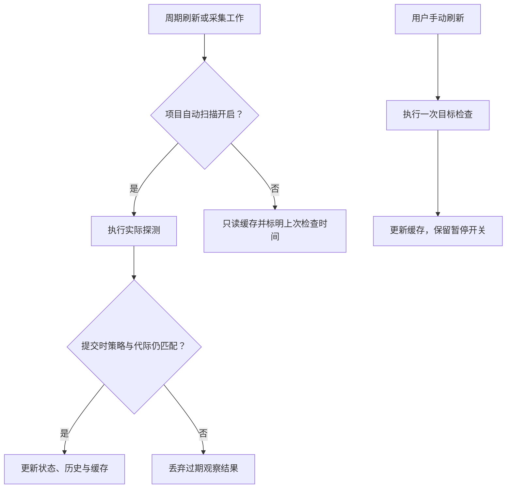

# Design

## Context

动机见 `proposal.md`。首轮实施前，项目使用 Python 标准库引擎、SQLite 状态库与原生 SwiftUI/AppKit。以下记录首轮实施前的基线。

- `backend/engine.py:database` 创建的项目表没有扫描策略、首次创建时间或置顶标记，服务表没有首次创建时间或独立自定义显示名。`snapshot` 每次对全部服务执行观察，按名称返回。
- `app/Sources/ServiceManager.swift:Store.start` 每 2 秒刷新；`filtered` 只过滤不排序。项目栏使用 `navigationSplitViewColumnWidth(min:210, ideal:240)`，默认窗口为 1200×740、最小为 1000×620。
- `backend/capture.py:collect` 独立于窗口工作。观察入口包括新进程或容器登记、既有进程的端口及名称更新、启动配方补齐，以及观察服务的结束状态核对。
- `capture.py:collect_once` 会重写自动观察进程的 `name`；`engine.py:record_spec` 也会覆盖重复登记名称，不能直接把用户名称与来源名称共用。
- `engine.py:operate`、`adoption.py:configure`、健康检查及停止逻辑目前共享 `services.spec`。运行中直接覆盖它会影响停止范围或当前健康地址。
- 项目删除已经有实时状态阻塞、事务回收及日志保留规则；服务删除应复用其原则，同时遵守用户明确选择：不写忽略标记，允许再次采集。
- 当前没有 OpenSpec 主规格；`specs/001-service-manager/` 和现有测试仍提供稳定身份、先停后启、数据保留及项目隔离基线。

## Goals / Non-Goals

**Goals:**

- 让所有观察入口遵守同一项目策略，列表读取、显式刷新和控制核验具有明确边界。
- 持久化与运行周期无关的服务元数据；旧数据迁移和项目恢复均不损坏现有记录。
- 将显示名、已生效配置、待生效配置及实际运行身份分开，保护正在运行的对象。
- 在现有原生结构内改善布局和入口，项目栏可选排序与置顶独立于服务列表固定排序契约。

**Non-Goals:**

- 不停止或卸载全局采集器，不改 hooks 信任、审批或本机业务运行方式。
- 不实现无 hook 的后台发现兜底，不扩大到远程服务，不重建 Docker/Compose 容器。
- 不添加永久忽略规则，也不增加全局永久清空、服务回收站 UI 或自动过期清理。
- 本规划不修改发布版本、标签或现有的项目结束策略。

## Decisions

### 1. 增量迁移和最小数据扩展

采用版本化 SQLite 增量迁移，在独立架构锁与事务下完成；使用独立于业务 `mutation_lock` 的架构锁，避免首次连接在已持有业务锁时递归阻塞。保持现有 UUID、服务标识、运行历史、日志路径和私密文件权限。

拟增加的字段/记录：

| 位置 | 数据 | 用途 |
| --- | --- | --- |
| projects | `auto_scan`，默认 1；`observation_revision`，默认 0 | 项目策略与观察工作的代际校验 |
| projects | `created_at`、`created_at_source`；`pinned`，默认 0 | 项目首次登记时间与置顶，不参与目录身份派生 |
| metadata | `project_sidebar_preferences`：`sort_key`、`direction` | 同一状态库的项目排序偏好，默认名称升序 |
| services | `display_name`，可空 | 用户名称覆盖来源名称，不参与服务 ID 生成 |
| services | `created_at`、`created_at_source` | 首次登记时间及真实/估算/未知来源 |
| services | `pending_spec`，可空；`config_revision` | 用户保存的下次配置和防止并发覆盖 |
| service_observations | 服务 ID、已脱敏观察结果、`checked_at` | 暂停时可读取的状态缓存，不作为控制依据 |
| metadata | `deleted_service:<uuid>` | 私密登记/历史回收记录，不是屏蔽列表 |

新服务和新项目登记使用各自真实登记时间。旧服务按其留存运行、旧项目按其所属服务的留存运行，分别使用 `MIN(runs.started)` 一次性回填，标为估算；没有可用运行时保存未知来源，内部排序可用零作为哨兵但 UI 不展示伪造日期。历史清理和再次启动不重算。已有项目回收记录没有新字段时，恢复使用兼容默认值；新回收记录完整保留新字段。要同步更新 `restore_project` 的固定字段清单和所有新增登记路径，避免恢复后丢失开关、创建时间或置顶。旧回收记录缺少置顶时默认关闭；缺少项目创建时间时，只从该回收记录实际保留的运行中估算，无证据则未知。排序偏好属于当前状态库，不被单个项目恢复覆盖。

备选是直接以最近运行时间排序、每次查询动态估算；这些都会在重启或清理历史后变化，因此不采用。

### 2. 项目扫描策略下沉到引擎和采集器

新增 `project_scan_policy(id, enabled)`，在业务变更锁内保存策略并递增 `observation_revision`。开关保存成功是暂停生效边界。默认不改变已有项目，尚无项目登记的目录继续按现有可信归属规则发现。

后台观察分成“选取允许项目 → 外部探测 → 校验策略代际 → 提交观察结果”。外部 `ps/lsof`、Docker 和 HTTP 探测不长时间占用全局变更锁；提交在同一策略锁内重查 `auto_scan` 和 revision，不匹配则丢弃。对当前会写运行状态的 `observe` 路径作相应拆分或事务包装，不能只在缓存写入前检查而已经修改运行记录。

`capture.py` 需覆盖以下路径：

- 启动事件与已恢复 `capture_tracking` 的项目过滤，不自动创建暂停项目的新登记。
- `record_process`、`record_container` 与 `collect_containers` 的提交前复核。
- 既有进程端口/名称更新、启动器范围和配方补齐。
- 结束状态自动核对，以及 `managed_processes` 等辅助扫描，避免继续针对暂停项目检查。

多个启用项目共享的系统进程表采样仍可能看见暂停项目 PID；不为暂停项目关联后代、执行专属检查或持久化新的观察结果。没有可处理的启用项目工作时跳过不必要的系统采样；内部采集器心跳继续保留。监督器为自己拥有的运行记录自然退出属于生命周期记账，不是应被暂停的外部轮询。

不选择只在 SwiftUI 中跳过刷新，因为采集器在窗口关闭后继续运行；也不停止全局采集器，因为会影响其他项目。

### 3. 区分界面轮询、显式刷新与操作核验

保留现有 JSON RPC 架构，将模式设为显式参数，避免界面定时器调用“强制刷新”：

| 调用 | 开启项目 | 暂停项目 |
| --- | --- | --- |
| `snapshot` / 计时器 | 正常观察并更新缓存 | 只读脱敏缓存与登记，不触发检查 |
| `refresh(project_id)` | 检查目标已登记服务 | 一次检查目标已登记服务，开关保持关闭 |
| `refresh(all)` | 检查全部已登记服务 | 显式包含暂停项目，完成后继续暂停 |
| 用户启停/重启/删除 | 核验真实身份和状态 | 同样核验，不相信缓存 |
| 已配置项目结束/退出操作 | 延续已有策略 | 延续已有策略和实时身份检查 |

缓存增加 `observation_paused`、`last_checked_at`、`state_fresh` 等投影字段。没有缓存时显示未知、尚未检查；不为了首次打开而探测暂停项目。计时器读取不能更新时间。项目统计和菜单栏中的缓存数量带有“含上次已知状态”提示，不将暂停状态写成一种新的进程状态。手动发现页仍是显式候选发现，不自动转换为接管。

快照批量读取服务、项目扫描策略和状态缓存，再探测需要实际检查的对象。窗口可见时约每 2 秒请求快照，关闭、最小化或隐藏后约每 10 秒更新菜单栏，重开窗口立即请求刷新。

采集器通过 FIFO 等待新检查点。若没有跟踪进程或近期 Docker 事件，轮次间等待约 5 秒，有活动时等待约 0.5 秒。事件目录变化时重读文件，并定期复查此前未能读取的事件。跟踪结果变化才持久化，心跳约每 5 秒写入一次，错误状态变化时提前写入。采集进程持有一个无活动事务的 SQLite 连接，减少短连接重复建立 WAL 共享内存的开销。

新服务创建、实际启停等显式操作可返回该次实际结果；它们不暗中重新开启扫描。恢复扫描后只认领仍存活且身份和归属可确认的对象，不把暂停期间已结束的事件制造为当前运行。

### 4. 统一名称投影和列表比较规则

数据库中的来源名称继续由原登记/采集路径维护；显示使用 `display_name` 非空优先，否则使用 `name`。改名校验复用项目名称的 1～100 字符和控制/不可见字符限制。自定义显示名不进入稳定 ID 的派生，因此运行、端口和后续登记不漂移或覆盖它。

比较键为 `(0 if state == 'running' else 1, -created_at_or_zero, service_id)`。严格使用 `running`，不复用 Swift 中把 `stopping`、`stop_failed` 也视为可能存活的 `running` 数量统计。引擎提供最终顺序，前端项目、搜索、状态筛选只保留相对顺序，不再各自重新按名称或运行开始时间排列。暂停服务按带陈旧提示的上次已知状态排序，不为排序另发探测。

### 5. 待生效配置与当前运行分离

`services.spec` 保持为当前已生效、可供身份和停止核验使用的配置；保存用户编辑时只写经过类型校验和白名单合并的 `pending_spec`，不覆盖当前 spec，也不调用 `observe`、健康请求或任何启停函数。

- 本机 process/task 可编辑 argv、cwd、显式 env 和 url；健康地址可清空。
- 用户已明确容器边界：container/compose 只允许显示名和 url；container ID、Compose 文件/项目/成员、命令和环境只读，不触发重建。
- 环境编辑传输新增/更新键与显式删除键，未出现的键保持原值；常规快照只返回键名及待生效摘要，不回传旧值。错误和操作摘要不打印环境值。
- `config_revision` 用于拒绝过期编辑覆盖新配置，失败时保留输入并要求刷新基线。
- `adoption.configure` 与新的 `service_configure` 共享校验及保存路径。已有观察服务补齐配置仍可形成下次启动配方，但不能改变当前运行的控制身份。
- 显式 start 在旧运行已结束、能力与身份核验通过后，从最新 pending 配置合并可编辑字段；观察元数据、source、management 和实际控制范围不能由表单覆盖。restart 必须先按旧 spec 完成 stop，再使用新配置 start。
- 成功创建新运行后清除对应版本的 pending 标记。停止失败或启动失败时保留待生效配置以便修正重试，不报告已经应用；失败尝试仍使用现有独立运行/操作记录。
- 健康地址也遵循下次启动语义，容器 url 继续保持实际发布端口绑定规则；旧运行不因为保存而改换探测地址。

备选是原地修改 spec，但它会影响当前停止判断；也不新增包含明文环境的完整运行配置快照到公开 run JSON，避免扩散环境值。

### 6. 删除是带实时核验的登记事务，不是屏蔽操作

新增 `service_delete_preview(id)` 与 `service_delete(id)`，预览显示对象、相关记录数量和阻塞原因；最终提交在变更锁内重新读取并实际核验。活动、停止失败、未知、未结束运行一律阻止。未知 Docker 状态不能降级为停止；删除本身不发信号、不执行 Docker rm。

通过后，同一事务将服务登记、运行及对应服务操作移入 `metadata.deleted_service:<uuid>`，从当前表和观察缓存移除。源码、日志文件、容器、镜像及卷保持原样。回收记录只留本机，不新增恢复 UI；不被自动发现用于排除、去重或继承旧配置。回收仅用于保留已知数据，不能成为用户明确否决的忽略标记。

如果后续可信观察再次满足登记条件，允许按现有标识算法重新登记；即使计算出的服务 ID 相同，也获得新的创建时间，不把已回收运行重新挂回。删除失败整笔回滚；UI 删除成功后清理选中服务、日志和历史视图，其他项目保持不变。用户处于暂停项目时仍须手动刷新/操作核验，不因缓存显示停止而放行。

### 7. 项目栏排序与置顶

项目排序使用独立于服务列表的设置，三种 `sort_key` 为 `name`、`created_at`、`running_count`，方向为 `asc` 或 `desc`。偏好存于当前状态库 metadata，避免不同测试/正式状态库串用；`pinned` 跟随项目稳定 ID 保存在 projects。采用同一引擎投影生成项目顺序，前端不另造一套规则。

先将真实项目按置顶与普通分成两组，每组按选定主键和方向排列，同值按项目 ID 升序决胜；方向只影响组内主键，不能反转置顶优先级。名称比较采用 Unicode NFKC 规范化与 casefold 后的稳定顺序，不依赖数据库未声明的排序规则。创建时间未知始终在组内已知值之后，包括升序模式。新项目默认不置顶，排序偏好缺失或无效回退名称升序。

运行数量来自每个项目全部所属服务的当前投影中严格 `state == 'running'` 的数量，与服务搜索/筛选无关；暂停项目使用已有缓存并保留新鲜度提示。切换排序和置顶只重排已有投影，不调用 observe、不更改扫描策略或触发启停。周期性获得真实新状态后数量排序可随之变化，同值仍稳定；不通过额外轮询追求位置即时更新。

新增 `project_pin(id, pinned)` 和 `project_sort_preferences(sort_key, direction)` RPC，在变更锁内校验目标/枚举并持久化，只返回更新元数据或复用已有投影。重复设置同值幂等，失败不覆盖旧偏好或丢失当前选择。前端将“全部项目”作为固定导航入口放在两个真实项目分组之前，不允许排序、置顶或拖动此入口。

项目名变化不会改变置顶或创建时间，但名称排序可改变组内位置。已有项目回收事务保留新增字段，恢复后按当前排序偏好归位；删除后若是新登记而非恢复旧登记，使用新创建时间与默认不置顶，回收记录不能成为自动采集忽略规则。

选择显式持久化而非仅在 SwiftUI 内存排序，是为了满足重启恢复与独立状态库隔离；选择组内沿用排序而非记录置顶先后，是为了避免引入用户未要求的另一套手工顺序。

### 8. 原生侧栏恢复和统一操作入口

在 `MainView` 中将项目栏约束改为 min 260、ideal 280，保留既有最小窗口尺寸与工具栏侧栏切换能力。使用固定、应用范围的偏好键持久化有效用户宽度，并通过小型 AppKit 分隔视图桥接识别实际拖动与恢复；SwiftUI 列表刷新不能重新应用初始值。

启动时先读取有效偏好，再按当前窗口为列表/详情保留的最小空间限制宽度；无效偏好回退 280。折叠宽度零及过渡测量值不写入偏好，避免下一次展开再次变窄。相比固定加大默认值，该方案能保留个人调整；不新建整套自绘三栏窗口。

项目栏提供可见的排序菜单及升降序切换，项目右键和当前项目菜单共用置顶/取消置顶动作，项目行显示置顶标记；移动项目时以稳定 ID 保持选择。项目菜单和详情展示扫描开关、暂停说明与更新时间。服务上下文菜单和详情复用同一配置/改名/删除动作及错误处理，表单按类型展示适用字段，并明确“下次启动生效”。界面忙状态只防重复点击，后端仍承担最终核验。

### 9. 批量调整已登记项目的扫描策略

「扫描管理」在项目栏提供独立勾选列表，显示各项目当前策略。全量操作覆盖提交时状态库中的已登记项目，包含置顶项目；多选按勾选的稳定项目 ID 提交。勾选状态与项目导航分开，当前项目、选中服务、项目排序和侧栏宽度在保存后保留。

后端在同一事务完成目标校验和策略更新，复用原有项目策略及观察代际。仅实际切换的项目递增代际，旧代际的在途自动观察仍按既有规则丢弃。选中项目已被删除等校验失败时，整批保留原值并提示重新选择。操作完成后返回实际变更数量，首次发现的项目继续使用默认开启值。既有按目录的 Codex 启动采集策略按原规则独立生效。

### 10. 将项目、服务和应用入口分开

| 位置 | 操作 |
| --- | --- |
| 左侧项目栏 | 排序、扫描管理。项目行右键可置顶、切换自动扫描、改名和删除项目登记。 |
| 服务列表顶部 | 添加服务、发现本机服务、手动刷新。选中具体项目后，右上角「⋯」提供置顶、扫描开关、改名、删除、结束工作及批量停止和重启。刷新标签随查看范围变化。 |
| 窗口工具栏 | 管理设置。项目栏折叠时仍可访问。 |

发现页继续展示全机候选对象。用户登记未登记容器时，在弹窗选归属项目，当前项目可作为初始选项；从「全部项目」打开时先选真实项目。查看候选和取消弹窗都保留原有登记和当前选择。手动刷新继续检查目标范围的已登记服务，保留各项目扫描偏好。

### 11. 列表简化状态，详情保留原始信息

| 列表状态 | 对应运行结果 |
| --- | --- |
| 运行中 | 已确认运行中 |
| 未运行 | 已停止、已退出、从未启动、任务成功或取消 |
| 处理中 | 启动中、停止中 |
| 需关注 | 失败、停止失败、未知；其他列表状态存在健康不可用或诊断问题时同时标出需关注 |

筛选显示「全部、运行中、未运行、处理中、需关注」。运行中服务的健康检查失败时，保留运行中徽标并显示告警图标及可访问说明，两个筛选均可找到该服务。「需关注」复用原有异常判断；原始运行结果、健康检查和诊断信息在详情及历史的对应位置可查。主列表和项目汇总的运行中数量以原始 `running` 为准，与已有排序一致。暂停及上次检查时间继续独立展示。展示分类只用于界面投影，操作仍依据原始状态和现有实时核验条件。

## Risks / Trade-offs

- [暂停后的状态会陈旧] → 明确暂停和检查时间，汇总标明含缓存，控制前实时核验。
- [共享采样无法按项目隔离整个系统进程表] → 不关联或专属检查暂停项目，全部业务工作暂停时跳过不必要采样，不承诺系统全局工具看不到该 PID。
- [暂停与在途采集竞争] → 策略代际校验和提交锁同时约束缓存与运行状态更新。
- [创建时间无法完整恢复] → 使用最早留存运行估算并注明来源，无数据明确未知；一次回填不随清理变化。
- [项目数量排序与真实运行存在时间差] → 使用已有投影，暂停项目保持缓存提示，不额外扫描；方向与相同主键的决胜规则明确。
- [配置修改导致当前运行失控] → pending 与 active 分离，先停旧配置再启新配置，失败保留待生效内容。
- [删除后又被自动添加] → 这是用户明确要求；确认提示说明会再次出现，不写屏蔽规则。
- [旧项目恢复或并发进程仍写旧结构] → 迁移更新恢复映射，验证独立 RPC/采集器重连；升级需在可控维护窗口退出旧版组件后重开，不操作业务服务。
- [原生布局随系统版本变化] → 在项目支持的 macOS 13+ 编译，并在实际桌面验收首次打开、重开、缩放、折叠与中文长项目名，不能只依赖构建通过。

## Migration Plan

1. 实施时先复制测试状态并准备真实旧 schema/旧回收记录夹具；应用前由用户备份正式状态目录，规划阶段不接触正式数据库。
2. 编写幂等版本化迁移，增加字段与观察缓存，默认保留扫描开启；事务分别回填项目和服务创建时间与来源，项目默认不置顶、缺失排序偏好采用名称升序，更新恢复兼容逻辑。失败整体回滚且不删除旧数据。
3. 在隔离状态完成跨项目采集、暂停竞争、项目排序/置顶/恢复、pending 配置和删除回归，再构建原生应用并完成真实 UI 验收。
4. 升级时用正常方式退出旧版管理/采集组件，保留业务服务；用新版引擎、应用和匹配的采集器加载同一状态。不自动更改 hooks 路径或信任配置。
5. 回滚时先保存新版状态，再使用升级前一致性备份与旧版应用恢复；不让旧引擎盲读新增配置和私密回收结构。代码回退不代表可以删除新增列或丢弃迁移后的历史。

本轮修订沿用现有项目扫描字段、观察缓存和运行历史。批量扫描与简化状态使用同一套底层记录，验收以新增任务为准。
